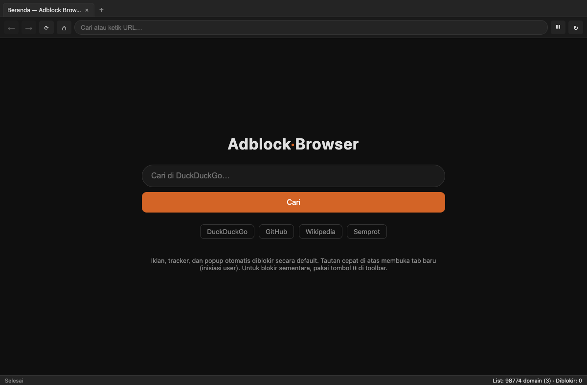

# Adblock Browser

Browser desktop berbasis **Electron** yang memblokir **iklan, tracker, popup, dan
redirect spam** — dengan isolasi session penuh. Dirancang untuk berselancar
bersih tanpa iklan popup yang membuka jendela-jendela baru.



## Fitur

| Fitur | Detail |
|---|---|
| **Blokir iklan & tracker** | `webRequest.onBeforeRequest` di level session membatalkan request ke domain terdaftar untuk semua resource type (script, image, xhr, ping, media, font, dsb). |
| **Blokir popup new-window** | Dua lapis: `setWindowOpenHandler` (backstop) + guard `window.open` berbasis *user-gesture*. Popup otomatis (non-klik) ditolak; yang inisiasi user dibuka sebagai **tab dalam aplikasi**, bukan jendela OS. |
| **Isolasi redirect** | Navigasi (termasuk redirect 3xx) ke domain iklan dialihkan ke halaman "Diblokir", bukan halaman kosong. |
| **Blocklist hybrid** | List statis bawaan + auto-refresh **EasyList + EasyPrivacy** tiap 24 jam; fallback offline ke list bawaan. Parser **path-aware** (lihat bawah). |
| **Allowlist** | `blocklist/allowlist.txt` — domain yang selalu diizinkan (mis. CDN video player). |
| **Isolasi session** | Partition `persist:adblock` terpisah: cookie/cache/penyimpanan web tidak bercampur dengan aplikasi lain. Semua izin (kamera, mik, notifikasi, geolokasi) ditolak. |
| **UI multi-tab** | Omnibox, back/forward/reload, tab strip, tombol ⏸ (jeda blocking) & ↻ (perbarui list), status bar jumlah domain + request yang diblokir. |

## Arsitektur

```
┌─────────────────────────────────────────────────────────────┐
│  main.js (proses utama)                                      │
│  ├─ session.fromPartition('persist:adblock')                 │
│  │    └─ webRequest.onBeforeRequest  → blokir domain iklan   │
│  ├─ did-attach-webview → setWindowOpenHandler per tab        │
│  └─ IPC: popup disetujui → buka tab dalam aplikasi           │
├─────────────────────────────────────────────────────────────┤
│  renderer/ (UI)  — tab strip, omnibox, multi-webview         │
│  └─ tiap <webview partition="persist:adblock">               │
│        └─ webview-preload.js → guard window.open + gesture   │
├─────────────────────────────────────────────────────────────┤
│  blocklist.js  — parser path-aware + matcher                 │
└─────────────────────────────────────────────────────────────┘
```

**Alur blokir iklan:**
1. Semua tab (`<webview>`) memakai partition `persist:adblock`.
2. `webRequest.onBeforeRequest` di session itu membatalkan request ke domain iklan/tracker. Navigasi utama ke domain terblokir dialihkan ke `pages/blocked.html`.
3. Redirect 3xx ke domain iklan otomatis tertangani — target redirect menjadi request baru yang ikut dicek.

**Alur blokir popup:**
1. `did-attach-webview` memasang `setWindowOpenHandler` ke tiap tab → domain iklan ditolak, sisanya dibuka sebagai tab dalam aplikasi.
2. `webview-preload.js` menimpa `window.open` dan mengirim ke main dengan flag *user-gesture*; popup tanpa gesture (< 900 ms) ditolak.

## Sistem blocklist (parser path-aware)

Kebanyakan ad-blocker sederhana memblokir *seluruh domain*. Ini berbahaya karena
banyak aturan EasyList/EasyPrivacy yang **spesifik path**, misalnya:

```
||cloudflare.com/cdn-cgi/trace$third-party   → hanya path /cdn-cgi/trace
```

Parser naif akan memblokir seluruh `cloudflare.com` → mematikan
`cdnjs.cloudflare.com` dan situs lain. Parser di proyek ini memisahkan
**domain** dan **path**, sehingga hanya path yang dimaksud yang diblokir.

Struktur data internal:

| Struktur | Isi |
|---|---|
| `blockedDomains` | Set host → blok seluruh domain + subdomain (`||domain^`) |
| `blockedPaths` | Map host → [path] → blok hanya path tertentu (`||domain/path^`) |
| `allowDomains` | Set host → izinkan seluruh domain (allowlist) |
| `allowPaths` | Map host → [path] → izinkan path tertentu (`@@`) |

Precedensi: **allow menang atas block**. Aturan allow dengan kondisi `$domain=`
dilewati (tidak bisa dievaluasi aman, dihindari jadi over-allow).

## Struktur proyek

```
adblock-browser/
├── main.js                 # Proses utama: window, blocking, gate popup, IPC
├── preload.js              # Bridge aman UI renderer (contextBridge)
├── webview-preload.js      # Guard window.open + lacak gesture per tab
├── blocklist.js            # Load/parse/match (path-aware)
├── config.js               # Konstanta (partition, URL sumber, search engine)
├── renderer/
│   ├── index.html          # UI browser (tab strip, toolbar, status bar)
│   ├── styles.css
│   └── renderer.js         # Logika multi-tab & navigasi
├── pages/
│   ├── start.html          # Beranda (lokal, tanpa iklan)
│   └── blocked.html        # Halaman saat domain terblokir
├── blocklist/
│   ├── default.list        # List statis bawaan (offline fallback)
│   ├── allowlist.txt       # Domain yang selalu diizinkan
│   ├── easylist.list       # Diunduh otomatis
│   └── easyprivacy.list    # Diunduh otomatis
├── scripts/
│   └── make-icon.py        # Generate icon.png + icon.icns
├── build/                  # icon.icns, icon.png (untuk packaging)
├── docs/                   # screenshot
├── blocklist-updater.js    # CLI refresh daftar
└── test-blocking.js        # Smoke test non-intrusif
```

## Menjalankan

```bash
npm install        # sekali saja (unduh binary Electron)
npm start          # jalankan browser
```

Perintah lain:

```bash
npm run update-lists   # ambil EasyList + EasyPrivacy dari jaringan
npm run smoke          # smoke test matcher (tanpa membuka jendela)
npm run icon           # regenerate icon
npm run dist           # build .app + .dmg + .zip (macOS)
```

## Build macOS

```bash
npm run dist
```

Menghasilkan:
- `dist/Adblock Browser-<versi>-arm64.dmg` (installer)
- `dist/Adblock Browser-<versi>-arm64-mac.zip` (portable)
- `dist/mac-arm64/Adblock Browser.app`

Ikon dihasilkan `scripts/make-icon.py` (shield oranye + simbol ⛔) → `build/icon.icns`.
Build **unsigned** — saat pertama dibuka, klik kanan → *Open* untuk melewati
Gatekeeper, atau sign dengan sertifikat Apple Developer.

## Bagaimana ini dibuat

### Keputusan desain
1. **Blocking di level session**, bukan per-tab — satu tempat, berlaku ke semua
   tab, dan terisolasi dari aplikasi lain lewat partition khusus.
2. **`<webview>` untuk multi-tab** — dipilih karena paling sederhana untuk
   browser multi-tab (meski `<webview>` sudah deprecated di Electron, tetap berfungsi).
3. **Popup gate dua lapis** — `setWindowOpenHandler` (sulit dibypass) + guard
   `window.open` (untuk deteksi *user-gesture* yang tak bisa dilihat handler).
4. **Parser path-aware** — menghindari false-positive besar (mis. memblokir
   seluruh `cloudflare.com`).

### Bug yang ditemukan & diperbaiki saat pengembangan

| Bug | Gejala | Perbaikan |
|---|---|---|
| Parser salah strip prefiks ADBlock (`||` dianggap `//`) | 0 domain terbaca | Strip `\|+` yang benar |
| URL EasyList 404 (repo pindah) | Update gagal | Ganti ke `easylist.to/easylist/*.txt` |
| `webview.canGoBack` dipanggil sebelum `dom-ready` | `canGoBack is not a function` | Defer ke `dom-ready` + try/catch |
| `did-attach-webview` argumen salah dibaca | `details.webContents` undefined | Argumen ke-2 adalah `webContents` langsung |
| `session.request()` tidak ada | `ses.request is not a function` | Ganti `session.fetch()` |
| `webRequest.onBeforeRedirect` tanpa callback | `cb is not a function` | Hapus handler (redirect ditangani `onBeforeRequest`) |
| Menu tanpa `editMenu` | Cmd+V paste tidak jalan | Tambah `{ role: 'editMenu' }` |
| Rule path dianggap domain (false positive) | Player video mati (cloudflare diblokir total) | Parser path-aware + allowlist `jwpcdn.com` |

## Pengujian

`npm run smoke` menjalankan `test-blocking.js` (tanpa jendela):
- Uji matcher: domain iklan diblokir, domain normal lolos.
- Uji live: request ke `ads.doubleclick.net` → `net::ERR_BLOCKED_BY_CLIENT`.

## Keterbatasan

- `<webview>` deprecated (tetap berfungsi, ada warning di konsol).
- Opsi aturan ADBlock (`$domain=`, `$third-party`, dll.) **diabaikan** — cukup
  untuk koverenansi umum, tidak selengkap uBlock Origin.
- Lapisan `window.open` butuh `contextIsolation=no` pada webview (tetap
  `nodeIntegration=off`); backstop utama `setWindowOpenHandler` tetap aktif.
- Build unsigned (belum notarized).

## Lisensi

MIT
